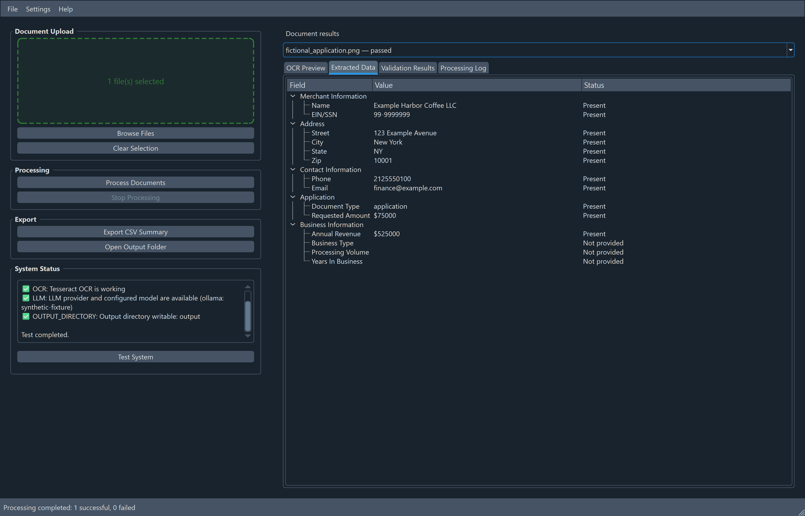

# MoneyPulse

**Python document intelligence combining OCR, configurable local AI, deterministic verification, and systems integration.**

MoneyPulse demonstrates an end-to-end document-processing architecture for merchant underwriting intake: PDF/image OCR, configurable local-model extraction, deterministic source reconciliation, schema and domain checks, review workflows, JSON/CSV exports, and optional CRM adapters. Its desktop application and headless CLI showcase modular Python engineering, provider abstraction, defensive data handling, and integration design.

**Document → OCR → source-backed field extraction → validation → analyst/underwriter review → downstream workflow**

**[Setup and troubleshooting](docs/SETUP.md)** · **[Architecture](docs/ARCHITECTURE.md)** · **[Project brief](docs/PROJECT_BRIEF.md)** · **[Contributing](CONTRIBUTING.md)**



Desktop review workflow using a fictional merchant document, Tesseract OCR, and a deterministic test provider.

## Engineering highlights

- **Python application architecture:** PySide6 desktop UI, headless CLI, reusable processing pipeline, and configuration management.
- **Document processing:** Tesseract OCR, Poppler PDF rendering, OpenCV preprocessing, and structured field extraction.
- **Model integration:** configurable Ollama, LM Studio, llama.cpp-compatible HTTP providers, and optional Hugging Face Transformers.
- **Data integrity:** deterministic source grounding, versioned schemas, domain validation, provenance, and explicit review state.
- **Systems integration:** local JSON/CSV outputs, optional CRM adapters, validation and approval gates, and safe CSV serialization.
- **Defensive engineering:** operation timeouts, configurable resource limits, structured error handling, and automated regression tests.

Explore the [architecture](docs/ARCHITECTURE.md), [verification history](docs/VERIFICATION.md), and [project brief](docs/PROJECT_BRIEF.md) for implementation details and reproducible checks.

## Download for Windows x64

[Standalone Windows EXE](https://github.com/JDavydovPortfolio/MoneyPulse/releases/download/v1.0.1/MoneyPulse-Local.exe) · [Windows x64 ZIP with samples](https://github.com/JDavydovPortfolio/MoneyPulse/releases/download/v1.0.1/MoneyPulse-Windows-x64.zip) · [SHA-256 checksum](https://github.com/JDavydovPortfolio/MoneyPulse/releases/download/v1.0.1/MoneyPulse-Windows-x64.sha256.txt)

Extract the ZIP and open `MoneyPulse-Local.exe`. The unsigned package includes Python and Qt, three fictional samples, and `START-HERE.txt`. It was tested on Windows 11 x64.

- **OCR** requires Tesseract with English data and `tesseract.exe` on PATH. For PDFs, also put Poppler's `pdfinfo.exe` and `pdftoppm.exe` on PATH. [Windows OCR setup](docs/SETUP.md)
- **Extraction** requires a running local model server and an installed model. Open **Settings → Configuration**, enter the server and model, and click **Test System**. The Windows executable supports Ollama, LM Studio, and llama.cpp-compatible HTTP endpoints. [Provider setup](docs/SETUP.md)
- **Local files** are stored under `%LOCALAPPDATA%\MoneyPulse`. Use **Open Output Folder** to find JSON and CSV exports. Startup and processing logs are saved under `logs` and `output\logs`.


## What MoneyPulse does

- Reads PDF and image documents with Tesseract OCR.
- Uses Ollama, LM Studio, llama.cpp-compatible servers, or optional Transformers to map OCR text into structured fields.
- Accepts a model-proposed value only when it can be reconciled with the OCR source text.
- Extracts merchant, contact, address, funding, and business fields when those values are present in the source document.
- Applies deterministic schema and domain validation.
- Preserves provenance so extracted values can be checked against the source.
- Produces local JSON and CSV artifacts for review and downstream workflows.
- Supports optional CRM integrations behind explicit approval gates.

Financial fields remain source-backed: accepted values reconcile to OCR evidence, and unsupported candidates are excluded from structured output.

## Why it exists

MCA underwriting often starts with merchant applications, scans, images, and supporting financial documents. Before an underwriter can evaluate a file, information has to be read, re-keyed, normalized, and checked against the original source.

MoneyPulse automates that intake and data-preparation layer so analysts can move from raw documents to structured, reviewable data while keeping source evidence attached to the workflow.

## Processing flow

```text
document
  -> OCR/source text
  -> local model proposes explicit field values
  -> source grounding
  -> schema + domain validation
  -> analyst / underwriter review
  -> local JSON / CSV
  -> optional downstream CRM / underwriting workflow
```

The local model supplies candidate field mappings; an independent verification stage reconciles each candidate against OCR source text before it enters structured output.

## Why use a local model?

OCR answers **what text is on the page**. It does not reliably answer **which pieces of that text belong in which structured business fields** when forms, labels, ordering, and layouts vary across ISOs and document types.

The local model handles semantic field mapping across varied forms, proposing values for merchant name, requested amount, address, annual revenue, years in business, and processing volume. MoneyPulse then independently verifies the candidates against OCR evidence.

This gives MoneyPulse two practical advantages:

- **Template flexibility:** different forms can use different labels and layouts without requiring a custom parser for every document template.
- **Local handling of sensitive data:** inference can run on the operator's machine or private network instead of requiring merchant document text to be sent to a hosted AI API.

The pipeline specializes in source-backed document intake and structured data preparation, with underwriting calculations and lending decisions handled as separate downstream workflows. Known rigid templates can use deterministic extraction, while local-model mapping supports variation in document wording and layout.

## Supported local-model providers

| Provider | Mode | Default endpoint |
| --- | --- | --- |
| Ollama | Local HTTP | `http://localhost:11434` |
| LM Studio | Local REST API | `http://localhost:1234` |
| llama.cpp | OpenAI-compatible local HTTP | `http://localhost:8080` |
| Hugging Face Transformers | In-process | Optional dependency set |

MoneyPulse defaults to **Qwen3 8B** for local extraction, the model used in the recorded successful Windows live-model workflow. Provider and model selection are configurable; [verification results](docs/VERIFICATION.md) document tested combinations.

## Quick start

Use Python **3.12 or 3.13** with Tesseract and Poppler installed.

```bash
git clone https://github.com/JDavydovPortfolio/MoneyPulse.git
cd MoneyPulse
python -m venv .venv
```

Activate with `.\.venv\Scripts\Activate.ps1` in Windows PowerShell or `source .venv/bin/activate` on Linux/macOS, then install the core dependencies. If PowerShell blocks activation, call `.\.venv\Scripts\python.exe` directly instead of `python`.

```bash
python -m pip install --upgrade pip
python -m pip install -r requirements-core.txt -c constraints-tested.txt
python examples/run_synthetic_demo.py
```

For the desktop application:

```bash
python -m pip install -r requirements.txt -c constraints-tested.txt
python main.py
```

For Ollama:

```bash
ollama pull qwen3:8b
```

LM Studio users can load a compatible Qwen3 GGUF and start the local API server on port 1234.

## Synthetic demo

The repository includes a deterministic demo built from fictional data. It creates a synthetic merchant document, performs real OCR, runs the extraction and validation pipeline, and writes local output.

The fixture provider is deterministic so the demo can exercise the pipeline without downloading a live model.

## Desktop application

The PySide6 desktop app supports document selection and drag/drop, OCR preview, structured field review, validation issues and review state, provider/model configuration, local JSON/CSV output, and batch result inspection.

Settings persist in git-ignored `config.yaml`.

## Headless use

```bash
python -m src.cli doctor
python -m src.cli process input --output output
```

The CLI uses the same extraction and validation pipeline as the desktop application.

## Source grounding and validation

Model-proposed field candidates pass deterministic source verification before they enter validated structured output.

Examples include matching requested funding amounts near request/funding language, matching revenue values near revenue language, matching processing-volume values near processing/volume language, and normalizing identifiers/contact fields before comparing them with OCR text.

Source grounding is followed by versioned schema validation and deterministic domain checks. The resulting structured data and provenance remain available for analyst/underwriter review before downstream use.

If no model document-type proposal is accepted, an explicit business/merchant-name label together with a requested-funding-amount label can classify the document as an application. Conflicting invoice, statement, agreement or contract wording disables this fallback. The derived classification is visibly flagged for review; it does not supply missing financial values or approve the document.

## Privacy model

When a local backend is selected, OCR and model inference can remain on the operator's machine or private network. Remote model endpoints require explicit `allow_remote_llm: true` configuration.

Network activity can still occur when packages or model weights are downloaded or when an optional external integration is intentionally configured.

Do not commit real merchant/applicant documents, credentials, tax identifiers, bank information, generated outputs, logs, or local configuration. See [SECURITY.md](SECURITY.md).

## Requirements

System dependencies:

- Tesseract OCR;
- Poppler for PDF rendering through `pdf2image`.

Python dependency sets are separated by purpose:

- `requirements-minimal.txt` — OCR modules;
- `requirements-core.txt` — headless pipeline and local HTTP providers;
- `requirements.txt` — desktop GUI;
- `requirements-transformers.txt` — optional in-process Transformers provider;
- `requirements-crm.txt` — optional CRM dependencies;
- `requirements-dev.txt` — tests/security tooling;
- `requirements-build.txt` — packaging tooling.

## Development

```bash
python -m compileall -q main.py src tests examples
python -m pytest -q
```

The deterministic provider tests use generated fictional data and do not require a live model server. OCR integration tests require Tesseract.

## Documentation

- [Architecture](docs/ARCHITECTURE.md)
- [Setup and troubleshooting](docs/SETUP.md)
- [Project brief](docs/PROJECT_BRIEF.md)
- [Synthetic examples](examples/README.md)
- [Contributing](CONTRIBUTING.md)
- [Security policy](SECURITY.md)
- [Changelog](CHANGELOG.md)

## License

MoneyPulse is licensed under the [MIT License](LICENSE).
