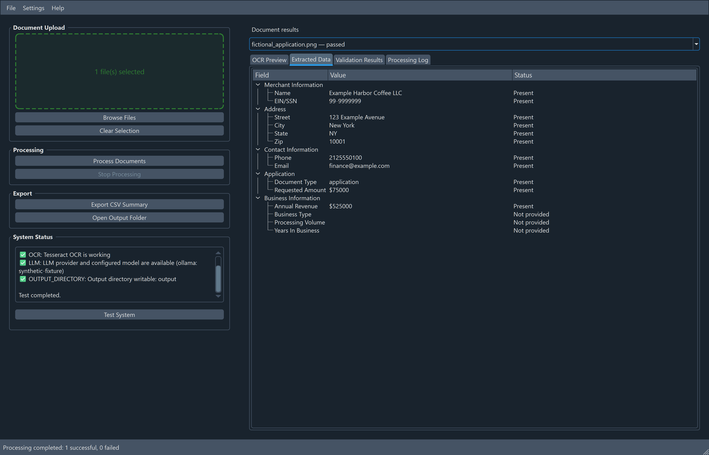

# MoneyPulse

**Local-first document intelligence for Merchant Cash Advance underwriting operations.**

MoneyPulse turns merchant applications and supporting financial documents into structured, source-backed data for analyst and underwriter review. It combines OCR, configurable local-model field extraction, source grounding, deterministic validation, local JSON/CSV output, and optional downstream CRM integrations.

**Document → OCR → explicit source-field extraction → source evidence → validation → human review → downstream underwriting calculations/rules**

**[Setup and troubleshooting](docs/SETUP.md)** · **[Architecture](docs/ARCHITECTURE.md)** · **[Project brief](docs/PROJECT_BRIEF.md)** · **[Contributing](CONTRIBUTING.md)**



Actual desktop screenshot using a generated fictional document and real Tesseract OCR.

## What MoneyPulse does

- Reads PDF and image documents with Tesseract OCR.
- Uses Ollama, LM Studio, llama.cpp-compatible servers, or optional Transformers to map OCR text into structured fields.
- Accepts a model-proposed value only when it can be reconciled with the OCR source text.
- Extracts fields such as merchant name, contact information, address, requested funding, and business information when those values are explicitly present in the source document.
- Applies deterministic schema and domain validation.
- Records source/provenance information so extracted values can be checked against the document.
- Produces local JSON and CSV artifacts for analyst/underwriter review and downstream underwriting workflows.
- Supports optional CRM integrations behind separate approval gates.

MoneyPulse does **not** ask the local model to invent missing revenue, processing volume, years in business, or other financial facts. If a source document does not contain a supported value, the field remains missing rather than being inferred.

## Why it exists

MCA underwriting often begins with merchant applications, statements, scans, images, and supporting financial documents. Before an underwriter can evaluate a file, information commonly has to be read, re-keyed, normalized, and checked against the original source.

MoneyPulse automates that document-intake and data-preparation layer. The model helps locate and structure information that appears in the document; it is not treated as an independent source of financial truth.

## Processing model

```text
document
  -> OCR/source text
  -> local model proposes field values
  -> each proposed value is checked against source text
  -> schema + domain validation
  -> analyst/underwriter review against source evidence
  -> local structured output
  -> deterministic underwriting calculations/rules in the approved downstream workflow
```

The distinction matters: source grounding can show that a proposed value appears in the OCR text. It does not prove that OCR read the document perfectly or that a merchant-reported figure is economically correct. Those questions remain part of review and underwriting.

MoneyPulse currently stops at source-backed extraction, validation, review state, and integration-ready output. It does not currently implement autonomous credit decisions or a generic underwriting policy engine. Any underwriting calculations or approval rules should operate on reviewed values under the lender/ISO's actual policy rather than on model guesses.

## Supported local-model providers

| Provider | Mode | Default endpoint |
| --- | --- | --- |
| Ollama | Local HTTP | `http://localhost:11434` |
| LM Studio | Local REST API | `http://localhost:1234` |
| llama.cpp | OpenAI-compatible local HTTP | `http://localhost:8080` |
| Hugging Face Transformers | In-process | Optional dependency set |

MoneyPulse defaults to **Qwen3 8B** for local extraction. **Qwen3 4B** is a lower-memory option.

The local model is used as a structured-field extraction aid. It is prompted not to guess, and MoneyPulse independently checks proposed values against OCR source text before accepting them.

## Quick start

Use Python **3.12 or 3.13** with Tesseract and Poppler installed.

```bash
git clone https://github.com/JDavydovPortfolio/MoneyPulse.git
cd MoneyPulse
python -m venv .venv
```

Activate the environment, then install the core dependencies:

```bash
python -m pip install --upgrade pip
python -m pip install -r requirements-core.txt -c constraints-tested.txt
python examples/run_synthetic_demo.py
```

For the desktop application:

```bash
python -m pip install -r requirements.txt -c constraints-tested.txt
python main.py
```

For Ollama:

```bash
ollama pull qwen3:8b
```

LM Studio users can load a compatible Qwen3 GGUF and start the local API server on port 1234.

## Synthetic demo

The repository includes a deterministic demo built from fictional data. It creates an image, performs real OCR, runs the extraction/validation pipeline, and writes local output.

The fixture demonstrates the trust boundary: if the deterministic test provider proposes a value that is not present in the generated OCR source, MoneyPulse rejects that value instead of accepting it merely because the provider returned it.

## Desktop application

The PySide6 desktop app supports:

- document selection and drag/drop;
- OCR preview;
- structured field review;
- validation issues and review state;
- provider/model configuration;
- local JSON/CSV output;
- batch result inspection.

Settings persist in git-ignored `config.yaml`.

## Headless use

```bash
python -m src.cli doctor
python -m src.cli process input --output output
```

The CLI uses the same extraction and validation pipeline as the desktop application.

## Trust boundary

Model output is untrusted. A proposed value must survive source grounding before it can propagate through the extraction pipeline.

Examples:

- a proposed requested amount must match an amount appearing in the OCR text near funding/request language;
- a proposed annual revenue value must match an amount appearing near revenue language;
- a proposed processing-volume value must match an amount appearing near processing/volume language;
- identifiers and contact fields are normalized and matched back to OCR text;
- missing values are not filled by model inference.

Source grounding reduces hallucinated field values. It does not replace human review of OCR quality, document meaning, or merchant-reported information.

## Privacy model

When a local backend is selected, OCR and inference can remain on the operator's machine or private network. Remote model endpoints require explicit `allow_remote_llm: true` configuration.

Network activity can still occur when packages or model weights are downloaded or when an optional external integration is intentionally configured.

Do not commit real merchant/applicant documents, credentials, tax identifiers, bank information, generated outputs, logs, or local configuration. See [SECURITY.md](SECURITY.md).

## Requirements

System dependencies:

- Tesseract OCR;
- Poppler for PDF rendering through `pdf2image`.

Python dependency sets are separated by purpose:

- `requirements-minimal.txt` — OCR modules;
- `requirements-core.txt` — headless pipeline and local HTTP providers;
- `requirements.txt` — desktop GUI;
- `requirements-transformers.txt` — optional in-process Transformers provider;
- `requirements-crm.txt` — optional CRM dependencies;
- `requirements-dev.txt` — tests/security tooling;
- `requirements-build.txt` — packaging tooling.

## Development

```bash
python -m compileall -q main.py src tests examples
python -m pytest -q
```

The deterministic provider tests use generated fictional data and do not require a live model server. OCR integration tests require Tesseract.

## Current scope

MoneyPulse is focused on document intake, source-grounded structured extraction, validation, reviewable local output, and integration-ready data preparation for MCA underwriting workflows.

It does not currently infer missing merchant financial facts, derive annual revenue or processing history from raw statements without dedicated statement-analysis logic, or make autonomous approval/decline decisions.

## Documentation

- [Architecture](docs/ARCHITECTURE.md)
- [Setup and troubleshooting](docs/SETUP.md)
- [Project brief](docs/PROJECT_BRIEF.md)
- [Synthetic examples](examples/README.md)
- [Contributing](CONTRIBUTING.md)
- [Security policy](SECURITY.md)
- [Changelog](CHANGELOG.md)

## License

MoneyPulse is licensed under the [MIT License](LICENSE).
