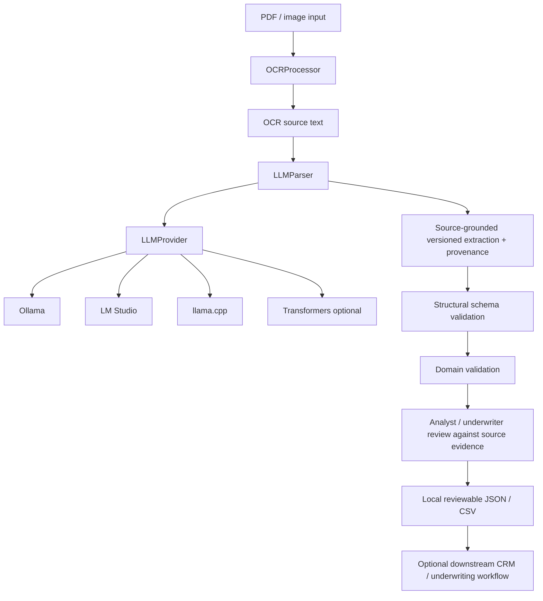

# MoneyPulse Architecture

MoneyPulse is a local-first document-processing pipeline with explicit boundaries between OCR source text, model-assisted field extraction, source grounding, deterministic validation, human review, and optional downstream systems.

## Processing flow



## Components

### `src/ocr.py`

Validates input paths and extensions, renders PDFs one page at a time with Poppler through `pdf2image`, preprocesses images with OpenCV, and extracts text with Tesseract. Render/OCR calls have timeouts. Missing files, unsupported types, corrupt images, and missing OCR tooling fail explicitly.

### `src/llm_providers.py`

Defines the model-provider interface. Local HTTP providers use explicit request timeouts and reject malformed response shapes. Provider connection tests also verify the configured model when the backend exposes a model list. The Transformers dependency is loaded only when that provider is selected.

### `src/llm.py`

Splits source text into word-bounded chunks and attempts each expected field across chunks. A provider-agnostic model layer generates candidate field mappings for deterministic source reconciliation.

A model-proposed field must reconcile with its originating OCR chunk before entering structured output. Accepted values retain source backing, raw attempts remain in provenance, and missing financial fields are preserved for reviewer follow-up.

Response cleanup strips only recognized field/answer prefixes, preserving legitimate colons inside values.

When no document-type proposal is accepted, the parser can derive `application` from explicit business/merchant-name and requested-funding-amount labels. It checks all chunks for conflicting invoice, statement, agreement or contract wording first. This fallback retains raw model attempts and adds a visible `flagged_issues` explanation, producing `needs_review` after domain validation. It never fills missing financial values.

### `src/schema.py`

Defines extraction schema version `1.0` and validates exact expected fields, nested types, review metadata, and provenance. Unexpected/missing schema elements fail closed rather than being silently coerced.

### `src/validator.py`

Runs structural validation first, followed by deterministic domain checks for fields such as EIN/SSN, ZIP code, amount, phone, email, state, required fields, and partial addresses. It produces explicit review state without inventing model confidence.

### `src/pipeline.py`

Coordinates OCR, parsing, validation, review state, and local output. A validation failure remains a reviewable completed extraction; a structural/provider/OCR exception returns an explicit failed processing result.

### `src/crm_submit.py`

The core `CRMSubmitter` creates local artifacts only. `EnterpriseCRMSubmitter` is an optional adapter and blocks network transmission until deterministic validation has passed and explicit human approval is present.

CSV string cells are escaped at serialization to reduce spreadsheet formula injection. JSON retains original values. The public connector rechecks literal boolean approval and state, and the submitter blocks transmission after local output failure.

### `src/gui/`

Contains the PySide6 desktop interface and a separate provider-discovery widget. The main configuration dialog supports the provider IDs consumed by the pipeline. Provider discovery remains separate to avoid coupling startup to scanning local services.

The desktop shows OCR text, extracted fields, validation/review state, local-model configuration, and batch results. Input/configuration changes and overlapping workers are blocked while processing is active.

### `src/config.py` and `src/cli.py`

Configuration is a bounded set of provider/model/OCR settings stored in ignored local YAML. The headless CLI reuses `DocumentPipeline`, performs preflight checks, handles explicit input/configuration failures, and emits local result summaries with meaningful exit codes. No GUI dependency is imported by the CLI.

## Trust boundary

```text
OCR text (source evidence)
    -> model-proposed candidate (pending source verification)
    -> source-grounded structured field
    -> schema validation
    -> domain validation
    -> human review against source evidence
    -> reviewed structured data
    -> optional downstream workflow
```

Model-proposed fields are accepted only after OCR reconciliation and deterministic validation, with missing values surfaced for review.

Statement-level underwriting metrics such as revenue, deposit history, and processing volume can be implemented as dedicated downstream calculation components with their own source evidence and validation.

## Provenance

Extraction provenance records source file, provider/model, document chunk count, and raw field attempts. This helps a reviewer distinguish source/model behavior from accepted structured values. Default CRM-shaped local output deliberately omits raw model-response provenance to avoid unnecessarily propagating model text downstream.

## Privacy boundaries

With a local backend selected, OCR and inference can operate on the operator's machine or private network. Network activities such as model downloads, opt-in remote inference, and approved CRM integrations are separately configurable. Operators manage endpoint exposure, credentials, filesystem permissions, retention, backups, and logs.

## Optional dependency boundaries

The default application does not require the in-process Transformers stack or enterprise SOAP/OAuth packages. Optional dependencies are separated into dedicated requirements files so unused integrations do not break the core application at import time.
